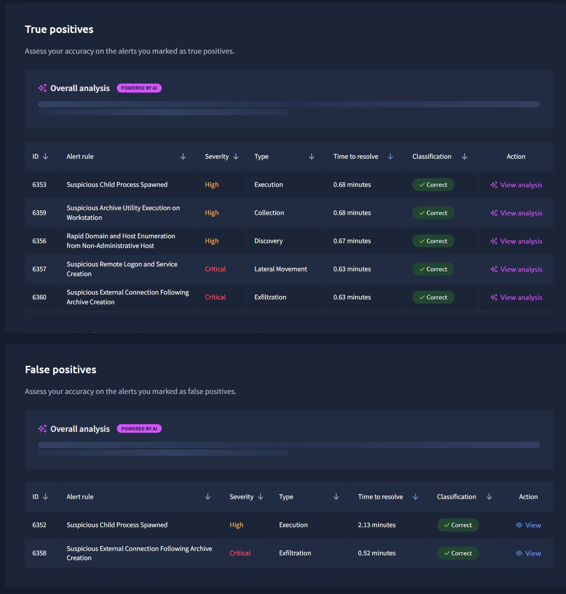
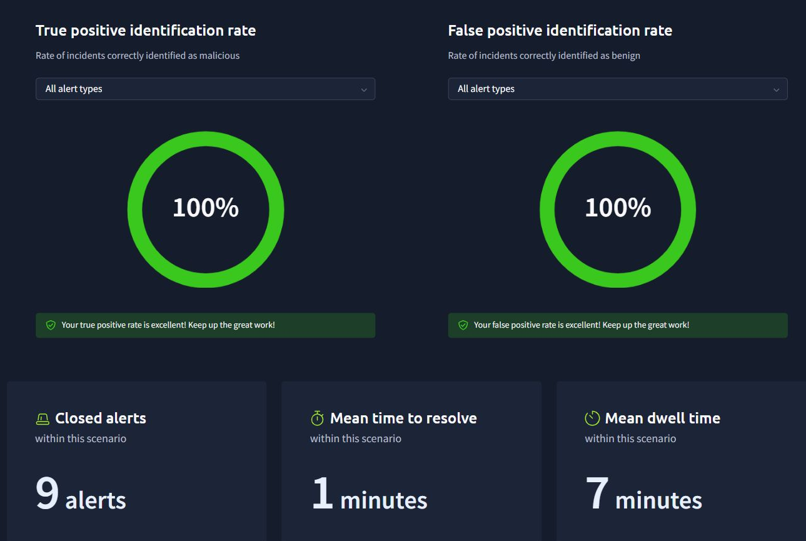
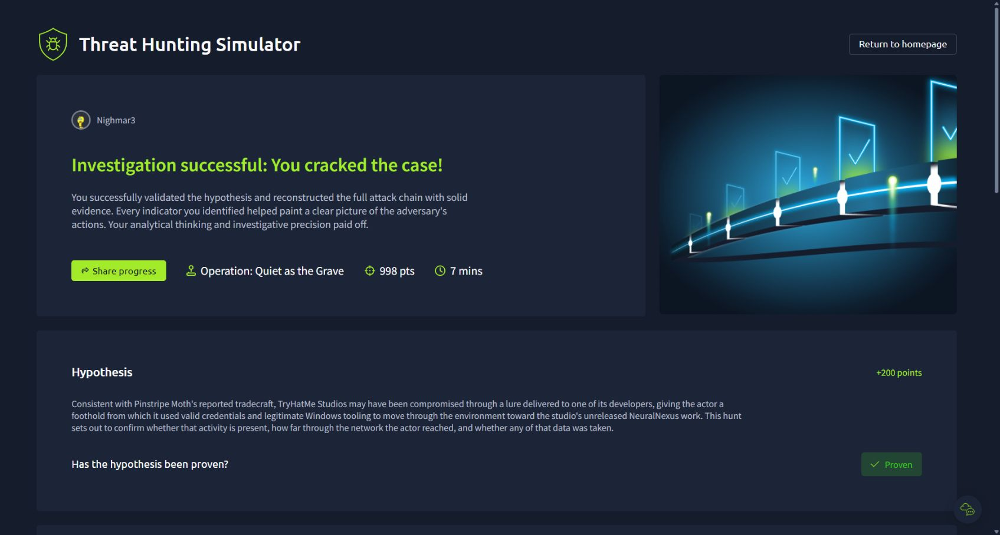
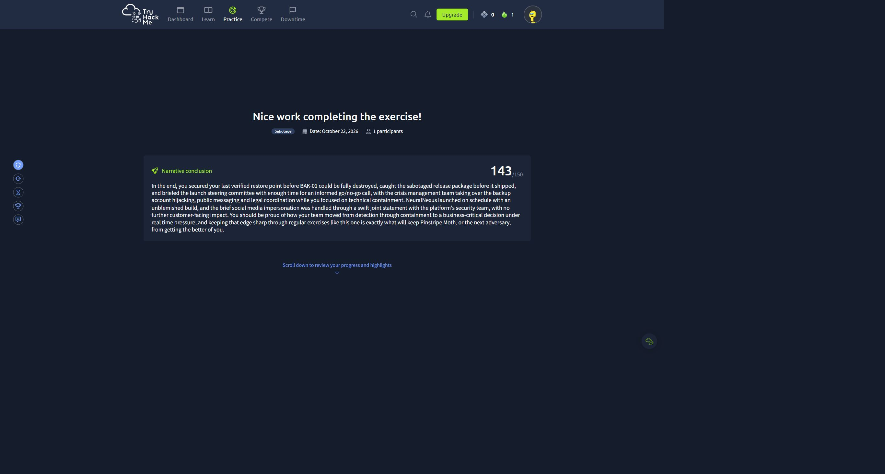
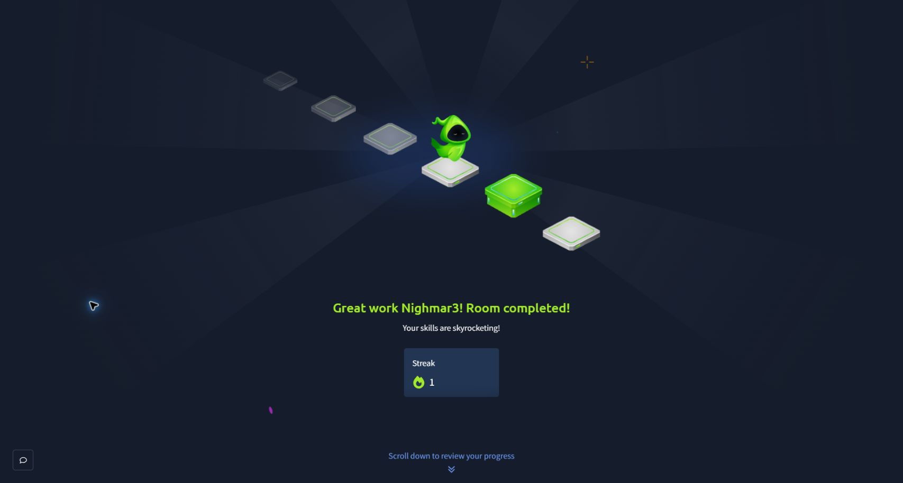
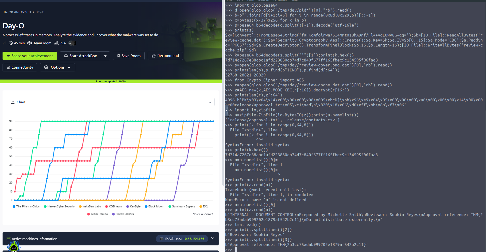
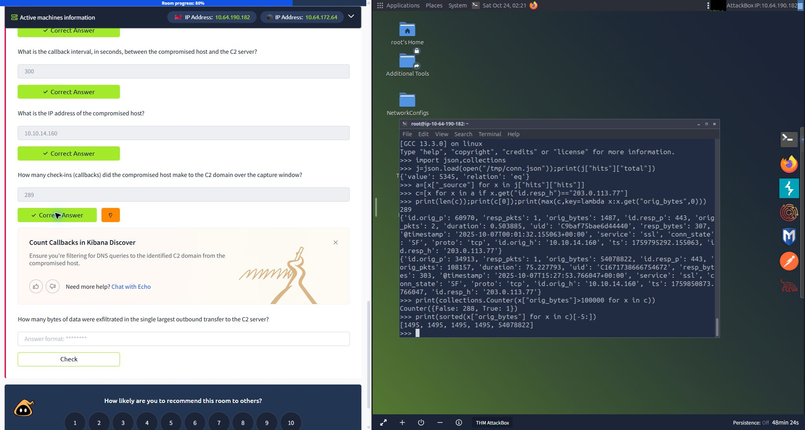
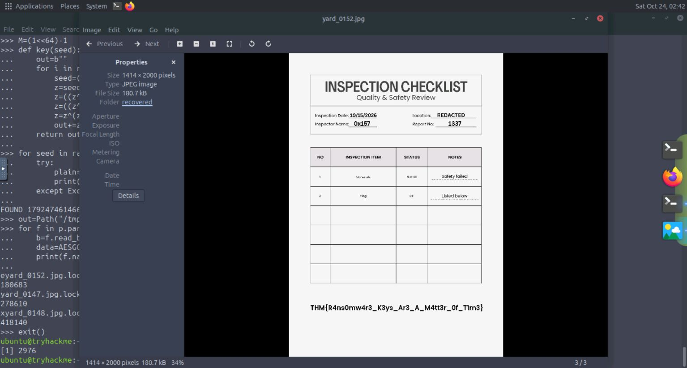
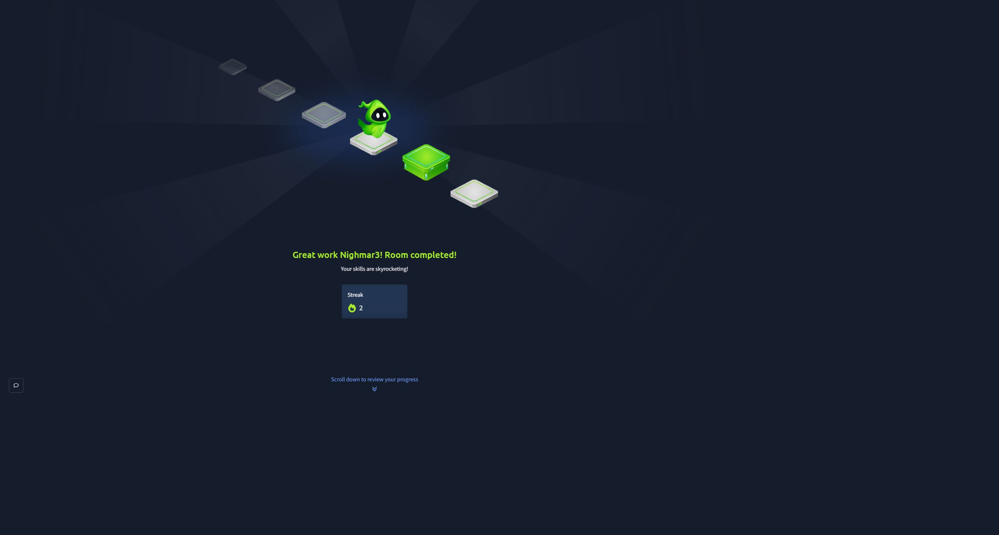

# It's Downtime! - TryHackMe Writeups
WRITEUP DEL EVENTO IT'S DOWNTIME! | TRYHACKME

Nighmar3 · CiberSecUNI

Ocho retos: triage SOC, threat hunting, respuesta a incidentes y análisis forense.

[PDF del dossier](WRITEUP.pdf) · [Scripts](scripts) · [Capturas y evidencias](evidencias) · [Guía del paquete](LEEME.md)

## Contenido

- [00. Alcance, resultados y lectura de la evidencia](#reto-00)
- [01. Repossessed: triage de alertas SOC](#reto-01)
- [02. Quiet As The Grave: reconstrucción de la intrusión](#reto-02)
- [03. Deadmen Tell No Logs: decisiones de respuesta](#reto-03)
- [04. Handbook for the Recently Compromised](#reto-04)
- [05. The Waiting Room: adjunto, ejecución y documento transferido](#reto-05)
- [06. Day-O: de memoria ejecutable a caché descifrada](#reto-06)
- [07. Strange & Unusual Activity: C2 entre tráfico legítimo](#reto-07)
- [08. Dead Endpoint: recuperación del ransomware](#reto-08)
- [09. Conclusiones y trazabilidad](#reto-09)

<a id="reto-00"></a>

## 00. Alcance, resultados y lectura de la evidencia

Este dossier reúne las soluciones trabajadas durante la sesión. El objetivo es explicar cómo se pasó de un indicio a una conclusión verificable, conservar las respuestas aceptadas y facilitar la reproducción de los análisis que cuentan con artefactos y comandos guardados.

Las capturas son pruebas de la sesión, no ilustraciones generadas. Los recortes se identifican como tales y se conserva la captura original. Los comandos se presentan normalizados para su lectura: se omiten errores de tecleo y problemas del escritorio remoto que no cambian el análisis.

| Reto | Resultado observado | Evidencia disponible |
|---|---|---|
| Repossessed | 9 alertas cerradas; TP y FP al 100 % | Captura de evaluación y alertas visibles |
| Quiet As The Grave | Investigación exitosa; 998 puntos | Captura final y cronología documentada |
| Deadmen Tell No Logs | 143/150 puntos | Conclusión narrativa del tabletop |
| Handbook for the Recently Compromised | 100 %; 5 respuestas aceptadas | Respuestas reconsultadas y extracto EVTX |
| The Waiting Room | 100 %; 6 respuestas aceptadas | Respuestas reconsultadas y captura final |
| Day-O | 100 %; 7 respuestas aceptadas | Memoria analizada, comandos y captura técnica |
| Strange & Unusual Activity | 100 %; 5 respuestas aceptadas | Registros Zeek, consultas y captura técnica |
| Dead Endpoint | 100 %; 6 respuestas aceptadas | Disco, desensamblado, recuperación autenticada y checklist |

### Criterios del informe

Se diferencia entre ejecución observada, intención deducida del código y resultado confirmado. Un comando de subida no acredita por sí solo la recepción remota. Un error de acceso no equivale a un movimiento lateral exitoso. Las fechas de los artefactos pertenecen a cada escenario; no se mezclan en una cronología única del evento.

Repossessed y el tabletop se documentan al nivel de detalle que conserva su evaluación. En The Waiting Room se recuperaron las respuestas aceptadas, pero no la transcripción técnica completa del análisis original: no se atribuye un algoritmo, nombre de intérprete o comando que no pueda verificarse con lo conservado.

<a id="reto-01"></a>

## 01. Repossessed: triage de alertas SOC

### Objetivo y enfoque

Marketing abrió un press kit sospechoso y el analista debía clasificar nueve alertas. El trabajo consistió en relacionar procesos, cuentas, activos y conexiones antes de decidir si cada señal representaba actividad maliciosa o una operación legítima.

La severidad y el nombre de una regla no bastan para emitir el veredicto. En la evaluación aparecen dos alertas con la misma categoría de proceso hijo sospechoso y dos de conexión externa tras compresión; dentro de cada categoría hubo actividad clasificada como verdadera y falsa positiva. Esto demuestra por qué el contexto de ejecución es decisivo.

### Resultados que conserva la evaluación

| ID visible | Regla / actividad | Clasificación aceptada |
|---|---|---|
| 6353 | Suspicious Child Process Spawned | Verdadero positivo |
| 6359 | Suspicious Archive Utility Execution on Workstation | Verdadero positivo |
| 6356 | Rapid Domain and Host Enumeration from Non-Administrative Host | Verdadero positivo |
| 6357 | Suspicious Remote Logon and Service Creation | Verdadero positivo |
| 6360 | Suspicious External Connection Following Archive Creation | Verdadero positivo |
| 6352 | Suspicious Child Process Spawned | Falso positivo |
| 6358 | Suspicious External Connection Following Archive Creation | Falso positivo |

La captura muestra nueve alertas cerradas y tasas de identificación de verdaderos y falsos positivos del 100 %. La tabla anterior reproduce las siete filas legibles en el resumen conservado; no reconstruye las otras dos clasificaciones sin evidencia.





### Lección operativa

Un buen cierre explica qué proceso actuó, quién lo ejecutó, qué produjo y por qué esa combinación sostiene la clasificación. La similitud entre alertas legítimas y maliciosas obliga a correlacionar eventos, no a clasificar por palabras clave.

<a id="reto-02"></a>

## 02. Quiet As The Grave: reconstrucción de la intrusión

### Hipótesis y alcance

La hipótesis del simulador proponía un acceso mediante un señuelo a un desarrollador, seguido de reutilización de credenciales y herramientas de Windows. La evidencia conservada confirma el helper malicioso, persistencia, credenciales de servicio, movimiento lateral y preparación de una transferencia externa. El canal de entrega inicial y la recepción efectiva del archivo en el servidor externo no quedaron demostrados por la telemetría revisada.

El resultado final fue una investigación exitosa con 998 puntos. Se conserva también una evaluación intermedia fallida; el resultado de referencia de este dossier es la captura final exitosa, no ese intento previo.

### Cronología: 10 de septiembre de 2026, UTC

| Hora | Hallazgo | Evidencia / alcance |
|---|---|---|
| 12:29:48 | Ejecución de review-helper.ps1 en THM-SREYES | Eventos 44850 y 9603; PowerShell desde Explorer |
| 12:37:20 | Copia del helper y clave Run NeuralNexusReview | 9613, 44895 y 44896; relanzamiento a las 12:44:04 |
| 13:01:41 | Lectura de deploy-settings.json | 9628; uso de username/password para PSCredential |
| 13:16:42 | WinRM hacia THM-LSULLIVAN | 9629, 7491, 22097 y 41089; ejecución remota confirmada |
| 13:48:25 | Intento de acceso a DC-01 | 9668 y 9671; AccessDenied, sin ejecución confirmada |
| 14:03:25 | Intento de alterar inventory.ps1 | 9672 y 9677; escritura denegada |
| 15:03:36 | Salto de IT a THM-MSMITH | 9678, 22221, 7653 y 42416 |
| 16:03:37 | Enumeración de usuarios, administradores y recursos | 9687, 42860, 42862 y 42864; algunas consultas denegadas |
| 16:27:28 | Creación de review-cache.zip | 9741 y 9801; staging de material accesible |
| 16:27:54 | curl.exe con --upload-file hacia el C2 | 9807 y 46271; comando de exfiltración observado |

### Correlación entre origen y destino

THM-SREYES (10.60.10.20) ejecutó el helper bajo s.reyes. El script configuraba el C2 `https://45.147.230.131:8443`, rutas `/register`, `/task` y `/result`, y un intervalo de 150 segundos. Más tarde se copió a AppData Local y se configuró una clave Run de usuario.

El acceso a `C:\StudioProjects\NeuralNexus\tools\deploy-settings.json` permitió construir credenciales para `svc-studioops`. La sesión remota no se confirmó solo por el New-PSSession del origen: un inicio de sesión de red tipo 3 y un proceso hijo de wsmprovhost.exe en THM-LSULLIVAN (10.60.10.21) acreditaron el acceso. La misma lógica permitió confirmar el salto a THM-MSMITH (10.60.10.22).

Por el contrario, los mensajes AccessDenied contra DC-01 y el script de mantenimiento son pruebas de intentos fallidos. No se estableció compromiso del controlador de dominio, ejecución como SYSTEM ni elevación administrativa exitosa.

### Consultas de reproducción

Los campos `event_id` de estas consultas identifican registros de la investigación; no deben confundirse con los códigos de evento Windows, como 4624 o 4104.

```text
index=* ComputerName="THM-SREYES" (event_id=44850 OR event_id=9603)
index=* (event_id=9629 OR event_id=7491 OR event_id=22097 OR event_id=41089)
index=* (event_id=9668 OR event_id=9671 OR event_id=22176)
index=* ComputerName="THM-SREYES" (event_id=9741 OR event_id=9801)
index=* ComputerName="THM-SREYES" (event_id=9807 OR event_id=46271)
```

### Colección y salida de información

Los comandos prepararon archivos de `approved-release` de Marketing y `release-notes` del proyecto en un directorio temporal, y los comprimieron como `review-cache.zip`. Después se observó curl.exe dirigido a `/ingest/review-cache.zip` en el mismo C2. No se conservaron una respuesta HTTP, el estado de salida ni una confirmación de recepción. Tampoco se inspeccionó el contenido completo del ZIP: no corresponde afirmar que se robó el build íntegro o los backups.



### Respuesta sugerida a partir de la evidencia

Contener los tres puestos implicados, cerrar las sesiones de svc-studioops, rotar las credenciales expuestas y preservar la clave Run y el helper antes de retirarlos. Revisar los permisos de WinRM y las rutas de despliegue, y buscar el mismo endpoint C2 en otros activos. Son recomendaciones derivadas del análisis, no acciones aplicadas a sistemas reales.

<a id="reto-03"></a>

## 03. Deadmen Tell No Logs: decisiones de respuesta

### Contexto y resultado

El evento identifica este ejercicio como Deadmen Tell No Logs. La captura final del simulador lo clasifica como Sabotage y muestra 143/150 puntos. Ambos nombres se conservan para evitar confundir el título de la tarjeta del evento con la categoría interna del ejercicio.

La conclusión narrativa confirma tres resultados: preservación del último punto de restauración verificado antes de la destrucción completa de BAK-01, detección del paquete de lanzamiento saboteado antes de distribuirlo y comunicación al comité de lanzamiento con tiempo para una decisión informada de continuidad.

También indica que el equipo de crisis se ocupó del secuestro de la cuenta de backup, la comunicación pública y la coordinación legal. NeuralNexus se lanzó con un build limpio. La suplantación en redes sociales se gestionó junto con la plataforma, sin impacto adicional sobre clientes según la narrativa del simulador.

### Lectura de la evaluación

El resultado es alto, pero no perfecto. Este writeup no presenta 143/150 como puntuación máxima ni inventa el texto de las quince decisiones. La evidencia conservada permite explicar el resultado y las prioridades de respuesta; no conserva una transcripción suficiente para reproducir cada opción elegida.

Las prioridades que ilustra el desenlace son preservar una restauración utilizable, separar contención técnica de coordinación de crisis y validar la integridad del paquete antes de decidir el lanzamiento. Se trata de una interpretación del resultado, no de citas literales de cada decisión.



<a id="reto-04"></a>

## 04. Handbook for the Recently Compromised

### Evidencia inicial y extracción

Se proporcionaron `Microsoft-Windows-Sysmon%4Operational.evtx` y `PowerShell-Operational.evtx`. Sysmon permite seguir las creaciones de procesos, mientras que PowerShell conserva bloques de script útiles para deshacer la fragmentación de cadenas.

```bash
evtx_dump ~/Desktop/artifacts/Microsoft-Windows-Sysmon%4Operational.evtx > /tmp/sysmon.xml
evtx_dump ~/Desktop/artifacts/PowerShell-Operational.evtx > /tmp/powershell.xml
```

El extracto completo se conserva en el paquete local de trabajo y se omite de esta publicación. Incluye tanto actividad preparatoria como la cadena del ataque; el primer evento del archivo no se toma automáticamente como el primer evento de intrusión.

### Cadena confirmada: 2 de octubre de 2026

| Hora UtcTime | Actividad |
|---|---|
| 05:02:05.238 | mshta.exe abre pipeline-check.hta desde Downloads de j.collins |
| 05:02:05.480 | PowerShell oculto resuelve certu*.exe y ordena la descarga |
| 05:02:06.830 | certutil.exe descarga pipeline-sync.ps1 desde pipeline-cdn.thm:8088 |
| 05:02:06.974 | PowerShell ejecuta el script temporal con -ep bypass |
| 05:02:08.209 | schtasks.exe crea StudioPipelineSync para ejecutarse al iniciar sesión |

La selección `gci C:\Windows\System32\certu*.exe` ocultaba parcialmente el nombre. La creación posterior del proceso certutil.exe resolvió la ambigüedad y confirmó la utilidad real. El bloque PowerShell también mostró un check-in a `/checkin`, la tarea programada y la escritura de una caché `.sync-cache` con la flag decodificada desde Base64.

El uso de mshta se asocia a `T1218.005` y la tarea programada a `T1053.005`, ambas respuestas aceptadas por el reto. En el extracto se observan limpiezas de logs previas a la cadena; sin atribución adicional no se presentan como una acción del intruso dentro de esta reconstrucción.

### Respuestas aceptadas

| Campo | Valor |
|---|---|
| Utilidad | `certutil.exe` |
| URL de segunda etapa | `http://pipeline-cdn.thm:8088/pipeline-sync.ps1` |
| Ejecución del adjunto | `T1218.005` |
| Persistencia | `T1053.005` |
| Flag | `THM{tH3_Gh0st_w1tH_Th3_M05T}` |

La flag no se obtuvo por adivinación. El bloque guardado concatena un Base64 en `$blob` y lo transforma con FromBase64String y UTF8.GetString. Para reproducirlo sin ejecutar el script, basta concatenar únicamente los literales de esa asignación y usar `base64.b64decode` en un intérprete de análisis.

<a id="reto-05"></a>

## 05. The Waiting Room: adjunto, ejecución y documento transferido

### Problema investigado

Michelle Smith recibió un correo de proveedor sobre pagos. Después de abrir un adjunto, su equipo contactó un servicio desconocido. El conjunto del reto incluía un EML, eventos Windows y un PCAP: tres fuentes que responden a preguntas distintas y deben relacionarse.

El EML identifica el adjunto real, los eventos muestran qué se ejecutó y el PCAP permite examinar las transferencias. El resultado final del reto fue 100 %. Las respuestas se volvieron a consultar en la página completada al preparar este dossier.

### Hallazgos y respuestas

| Campo | Valor aceptado |
|---|---|
| SHA-256 del adjunto incrustado | `e3e53f2e21df0b56eeb62d50146c4d69eb8cbc1bab5b8ba13f8ba5859870f6b3` |
| Carácter usado en el nombre | `U+202E` |
| Host de la etapa descargada | `portal.meridian.thm` |
| PID del intérprete | `1996` |
| Clave del documento transferido | `3c7a8c88466f5b869bea15f333e3be01` |
| SHA-256 del documento recuperado | `c19c4964c2a77872c49750cc1c2dd443b48fba984b41988aec6fbc780faed09a` |


### Cómo sustentar cada respuesta

Extraer los bytes de los adjuntos MIME y calcular SHA-256 permite identificar el archivo sin depender del nombre visible. Para examinar el nombre conviene mostrar su representación escapada y los puntos de código: U+202E altera la dirección de presentación del texto, por lo que la extensión aparente puede inducir a error.

El PID debe salir del evento que crea el intérprete, no del proceso padre ni del proceso de descarga. El host descargador debe contrastarse con DNS o la petición observada. Finalmente, el hash del documento corresponde a los bytes recuperados, no al contenedor cifrado de la captura.

Los siguientes comandos son una guía de reproducción, no una transcripción conservada de la sesión original:

```python
from email import policy
from email.parser import BytesParser
from pathlib import Path
import hashlib

msg = BytesParser(policy=policy.default).parsebytes(Path('correo.eml').read_bytes())
for part in msg.iter_attachments():
    name = part.get_filename() or ''
    payload = part.get_payload(decode=True)
    print(repr(name), ['U+%04X' % ord(c) for c in name])
    print(hashlib.sha256(payload).hexdigest())
```

No se conserva en este paquete el PCAP ni el adjunto original de este reto. Por ello no se afirma un modo de cifrado, un nombre de intérprete o una secuencia detallada de comandos que las respuestas guardadas no acreditan por sí solas.



<a id="reto-06"></a>

## 06. Day-O: de memoria ejecutable a caché descifrada

### Identificación y extracción

El volcado `memory.mem`, de unos 4,1 GB, se examinó con Volatility 3 y los símbolos incluidos. El proceso sospechoso fue ReviewClient.exe, PID 6260. Malfind señaló una región privada `PAGE_EXECUTE_READWRITE` de `0x8e0000` a `0x8e0fff`. La protección es un indicio; el contenido y los archivos relacionados permitieron sostener la conclusión.

```bash
cd ~/Desktop/artifacts
mkdir -p /tmp/day
vol -f memory.mem -o /tmp/day windows.malware.malfind --pid 6260 --dump
vol -f memory.mem windows.handles --pid 6260
vol -f memory.mem -o /tmp/day windows.dumpfiles --pid 6260
```

Los handles relacionaron el proceso con `review-cover.png` y `review-cache.dat`, dentro del paquete de revisión documental. La comparación del payload con el PNG recuperado encontró el código en el desplazamiento 28829. La marca IEND comienza en 28821; el código está después del cierre del último chunk y su CRC. Esto sostiene `T1027.009`, Embedded Payloads. La respuesta inicialmente considerada, T1027.003, no fue aceptada y se corrigió con esta comprobación de bytes.

### Desofuscación estática

El shellcode x86 apilaba inmediatos y restaba 0x25 a los bytes para reconstruir un comando. Resolvía WinExec, confirmado por la cadena construida y la búsqueda de exportaciones. La respuesta aceptada fue `kernel32.WinExec`.

La cadena reconstruida invocaba PowerShell con EncodedCommand. Se decodificó el Base64 como UTF-16LE sin ejecutar PowerShell. El script configuraba AES-CBC y PKCS7, y utilizaba los primeros 16 bytes de `review-cache.dat` como IV. Su salida prevista era `review-cache.zip`.

El descifrado produjo un ZIP con `release/approval.txt` y `release/contacts.csv`. La referencia de aprobación del primer archivo contenía la flag. La lectura del ZIP fue posible pese al relleno de páginas del archivo recuperado de memoria.

### Respuestas aceptadas

| Campo | Respuesta |
|---|---|
| Ejecutable | `ReviewClient.exe` |
| Dirección inicial | `0x8e0000` |
| Archivo con el mismo payload | `review-cover.png` |
| Subtécnica | `T1027.009` |
| API | `kernel32.WinExec` |
| Clave hexadecimal | `7d714a7267e88abc1afd223830cb74d7c840f677ff165fbec9c134595f06faa8` |
| Flag | `THM{2b3cc75adab999202e1879af542b2c11}` |



El script de reproducción se incluye como `scripts/day-o-recuperar.py`. Sus offsets están ajustados al payload de este reto; no son una regla general para cualquier shellcode. Requiere los archivos extraídos por Volatility y el entorno analysis-python con Crypto.

### Reconstrucción del comando y lectura del ZIP

El núcleo de la recuperación se puede revisar sin invocar la cadena reconstruida. La operación sobre los inmediatos devuelve los bytes en el orden que tendrían en la pila; después se deshace la resta y se decodifica la capa de PowerShell:

```python
import base64, io, zipfile
from Crypto.Cipher import AES

# d contiene el volcado de la región del PID 6260.
b = b''.join([d[i+1:i+5] for i in range(0x8d, 0x529, 5)][::-1])
command = bytes((x - 0x25) % 256 for x in b)
stage = base64.b64decode(command.split()[-1]).decode('utf-16le')
key = base64.b64decode(stage.split("'")[1])
# r contiene review-cache.dat recuperado de memoria.
plain = AES.new(key, AES.MODE_CBC, r[:16]).decrypt(r[16:])
archive = zipfile.ZipFile(io.BytesIO(plain))
print(archive.read('release/approval.txt').decode())
```

<a id="reto-07"></a>

## 07. Strange & Unusual Activity: C2 entre tráfico legítimo

### Preparación y fuentes

Se investigó un día completo, el 7 de octubre de 2025, en los índices zeek-dns y zeek-conn de Kibana. Había 3995 registros DNS y 5345 conexiones. Las búsquedas usadas en el análisis incluyeron todos los documentos, evitando sacar conclusiones sobre un conjunto truncado.

Los dominios con muchas consultas no son necesariamente maliciosos. En este conjunto también aparecían comprobaciones de conectividad y telemetría. El dominio que se correlacionó con el comportamiento del puesto afectado fue `edge-metrics-sync.net`, que resolvía a `203.0.113.77`.

### Consultas y comprobaciones

Seleccionar la ventana completa del día de captura y filtrar DNS:

```text
query : "edge-metrics-sync.net" and id.orig_h : "10.10.14.160"
```

Se encontraron 289 consultas, todas del mismo origen. Los intervalos fluctuaban alrededor de 300 segundos, con promedio de 299,66 entre la primera y la última consulta. La variación no elimina el patrón periódico; no se exige que cada diferencia sea exactamente 300.

Después se examinaron las conexiones al destino resuelto:

```text
id.orig_h : "10.10.14.160" and id.resp_h : "203.0.113.77"
```

Ordenando `orig_bytes` de mayor a menor apareció una conexión con 54078822 bytes enviados y 303 recibidos, servicio SSL, TCP/443 y estado SF. Comenzó a las `2025-10-07T15:27:53.766047+00:00` y duró 75,227793 segundos. Su UID es `C1671738666754672`.

### Por qué el conteo aceptado es 289

Había 288 conexiones pequeñas y una transferencia masiva. La pista del reto pide contar las consultas DNS al dominio desde el host comprometido, por lo que la respuesta aceptada es 289. Restar la transferencia masiva para contestar 288 cambiaría el criterio solicitado.

`orig_bytes` mide los bytes enviados por el iniciador de la conexión. No se debe sustituir por los paquetes enviados, por `resp_bytes` ni por la suma de ambos sentidos. La telemetría de conexiones sostiene la magnitud de la salida; no revela por sí sola qué documentos viajaron dentro de SSL.

| Campo | Respuesta aceptada |
|---|---|
| Dominio C2 | `edge-metrics-sync.net` |
| Intervalo | `300` segundos |
| Host comprometido | `10.10.14.160` |
| Callbacks según el filtro DNS | `289` |
| Mayor transferencia | `54078822` bytes |



### Comprobar el resultado exportado

Este ejemplo reproduce la comprobación de la respuesta JSON de Elasticsearch. Requiere exportar de nuevo conn.json desde el laboratorio; ese conjunto no se conserva en el paquete. La igualdad entre hits.total y la longitud de hits evita analizar solo la primera página de resultados.

```python
import json
response = json.load(open('/tmp/conn.json'))
hits = response['hits']
assert hits['total']['relation'] == 'eq'
assert len(hits['hits']) == hits['total']['value']
rows = [h['_source'] for h in hits['hits']]
c2 = [r for r in rows if r.get('id.orig_h') == '10.10.14.160'
      and r.get('id.resp_h') == '203.0.113.77']
largest = max(c2, key=lambda r: r['orig_bytes'])
print(len(c2), largest['orig_bytes'], largest['uid'])
# 289 54078822 C1671738666754672
```

<a id="reto-08"></a>

## 08. Dead Endpoint: recuperación del ransomware

### Preservar y montar la evidencia

Se trabajó sobre `disk.img`, una imagen de unos 12 GB. mmls mostró la partición principal en el sector 2099200. Con sectores de 512 bytes, el desplazamiento es 1074790400. El montaje incluyó solo lectura y noload para no reproducir el diario del sistema de archivos.

```bash
cd ~/Desktop/artifacts
mmls disk.img
sudo mkdir -p /mnt/dead
sudo mount -o ro,noload,loop,offset=1074790400 disk.img /mnt/dead
```

### Reconstruir la ejecución

La aplicación estaba en `/srv/gallery/app/gallery.py`. El endpoint POST `/api/albums/<int:album_id>/export` interpolaba `selection` en un comando tar que pasaba a subprocess.run con shell=True. El parámetro no estaba separado como argumento seguro de un proceso.

Para examinar SQLite se copiaron la base, el WAL y el SHM a un directorio de trabajo, manteniendo la imagen montada sin cambios. Es importante hacer la expansión del comodín dentro del contexto con permisos de lectura: el usuario sin privilegios no podía recorrer todos los directorios de la evidencia.

```bash
mkdir -p /tmp/dead
sudo sh -c 'cp /mnt/dead/srv/gallery/data/gallery.sqlite3* /tmp/dead/'
sudo sqlite3 /tmp/dead/gallery.sqlite3 'select * from exports;'
```

La tabla exports conservó un trabajo del álbum 1 que añadía, después de un punto y coma, una descarga mediante curl, un cambio de permisos y el lanzamiento de `/srv/gallery/.cache/.indexd`. El trabajo fue solicitado a las 05:36:54.547 UTC del 20 de octubre de 2026 y terminó a las 05:36:54.753. Esa evidencia, junto con el código vulnerable, identificó `/api/albums/1/export` como el endpoint abusado.

### Identificar el cifrado sin ejecutar el archivo

```bash
B=/mnt/dead/srv/gallery/.cache/.indexd
sudo sha256sum "$B"
sudo strings "$B" | grep -E 'EVP|AES|RAND|clock|locked|originals'
sudo objdump -d -M intel "$B" > /tmp/index.dis
```

El archivo era un ELF x86-64 y su SHA-256 fue `6a0e5b25a919a94952b34e38d8e8b595036d1ef6a026bf5cca38a0d34459102f`. Importaba EVP_aes_256_gcm y apuntaba a tres JPEG bajo `/srv/gallery/media/originals`. El análisis se hizo sobre bytes y desensamblado: el ransomware no se ejecutó.

### Debilidad en la generación de clave

La rutina consultaba CLOCK_REALTIME y calculaba una semilla como `segundos * 1000 + nanosegundos // 1000000`. Desde ella generaba cuatro salidas de SplitMix64, cada una serializada en little endian, para formar la clave AES de 32 bytes. El nonce de 12 bytes se generaba con RAND_bytes y quedaba en el archivo.

Una primitiva criptográfica fuerte no compensa una clave predecible. Las marcas de cambio de los archivos y el registro del trabajo situaron el inicio del cifrado en un intervalo de milisegundos. Se probaron semillas cercanas al instante observado y se verificó cada candidata mediante GCM, no solo buscando una cabecera JPEG plausible.

### Formato de archivo recuperado

| Offset | Longitud | Contenido |
|---|---|---|
| 0 | 4 | Magic GPH1 |
| 4 | 1 | Versión observada: 1 |
| 8 | 8 | Tamaño original, little endian |
| 16 | 12 | Nonce GCM |
| 28 | 16 | Etiqueta de autenticación |
| 44 | 4 | Relleno / campo no usado por el descifrado reproducido |
| 48 | Resto | Texto cifrado |

Los primeros 28 bytes se usan como AAD. La API AESGCM de cryptography recibe el texto cifrado seguido de la etiqueta; por ello se reconstruye `datos[48:] + datos[28:44]`, con nonce `datos[16:28]` y AAD `datos[:28]`.

```python
plain = AESGCM(key(seed)).decrypt(
    data[16:28], data[48:] + data[28:44], data[:28]
)
```

La semilla correcta fue `1792474614662`. Se validó para las tres imágenes con autenticación GCM y tamaños originales coherentes: yard_0147.jpg, 278610 bytes; yard_0148.jpg, 418140 bytes; yard_0152.jpg, 180683 bytes. La última contenía el checklist de inspección.



### Respuestas aceptadas

| Campo | Respuesta |
|---|---|
| Endpoint | `/api/albums/1/export` |
| Ejecutable | `/srv/gallery/.cache/.indexd` |
| SHA-256 | `6a0e5b25a919a94952b34e38d8e8b595036d1ef6a026bf5cca38a0d34459102f` |
| Algoritmo y modo | `AES-256-GCM` |
| Semilla | `1792474614662` |
| Flag | `THM{R4ns0mw4r3_K3ys_Ar3_A_M4tt3r_0f_T1m3}` |

### Reproducción del descifrado

El archivo `scripts/dead-endpoint-recuperar.py` incluye la derivación completa y valida tanto la etiqueta como el tamaño original. Escribe archivos nuevos en una carpeta distinta y se niega a sobrescribir un destino existente.

```bash
sudo python3 scripts/dead-endpoint-recuperar.py \
  /mnt/dead/srv/gallery/media/originals /tmp/recuperadas
```



<a id="reto-09"></a>

## 09. Conclusiones y trazabilidad

Los retos comparten una misma disciplina: correlacionar fuentes y comprobar el resultado. En Windows, la creación de procesos resolvió la ambigüedad del comodín usado para certutil. En memoria, el desplazamiento del código después de IEND permitió corregir la clasificación de ocultación. En red, se distinguió el conteo DNS de las conexiones pequeñas. En disco, la autenticación GCM convirtió una hipótesis de semilla temporal en una recuperación verificable.

Las limitaciones también forman parte del resultado. En threat hunting se acreditó la ejecución del comando de exfiltración, pero no la recepción remota ni el robo del build completo. En Repossessed se conservaron las métricas y parte de las clasificaciones, no la investigación completa de las nueve alertas. En el tabletop se conserva el desenlace, no todas las decisiones. Estas diferencias se mantienen visibles para que una evaluación de la plataforma no sustituya a la evidencia técnica.

### Fuentes primarias y referencias

- Página del evento y títulos oficiales: https://tryhackme.com/downtime
- Repossessed: https://tryhackme.com/soc-sim/scenarios?scenario=repossessed
- Quiet As The Grave: https://tryhackme.com/threat-hunting-sim/scenarios?scenario=quiet-as-the-grave
- Tabletop del evento: https://tryhackme.com/tabletop-exercises/exercises?exercise=6ad661d34d8777bc630645b5
- Handbook: https://tryhackme.com/room/handbookfortherecentlycompromised
- The Waiting Room: https://tryhackme.com/room/thewaitingroom
- Day-O: https://tryhackme.com/room/dayo
- Strange & Unusual Activity: https://tryhackme.com/room/strangeunusualactivity
- Dead Endpoint: https://tryhackme.com/room/deadendpoint
- Embedded Payloads: https://attack.mitre.org/techniques/T1027/009/

La página del evento y las respuestas completadas de Handbook y The Waiting Room se reconsultaron al redactar el dossier. El resto de los resultados se apoya en capturas, notas y datos de la sesión conservados en el paquete. Los enlaces de plataforma pueden requerir inicio de sesión.

### Contenido del paquete

`README.md` es la versión editable; `WRITEUP.pdf`, la versión maquetada. La carpeta evidencias conserva capturas originales y recortes identificados. La carpeta scripts incluye las dos rutinas de recuperación. Los extractos crudos y las etapas completas se conservan en el paquete local; se omiten de la versión publicada en GitHub. El PDF corresponde al dossier original y sus referencias a fuentes describen ese paquete local. `MANIFEST.sha256` permite comprobar la integridad de los archivos entregados.
